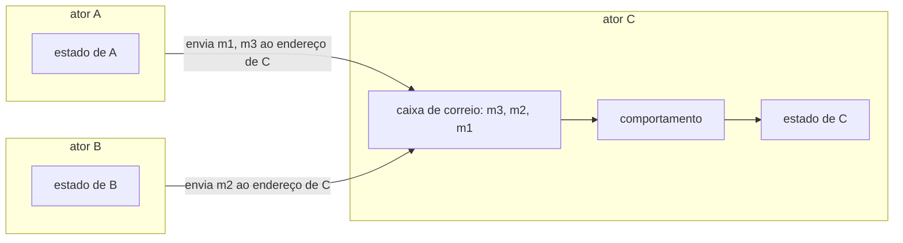
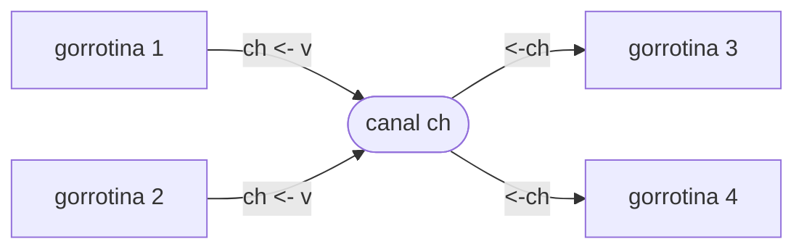

# Paradigmas de Programação — Aula 09: Modelo de atores com Elixir — O modelo de atores

## Introdução

A aula 08 apresentou dois modelos de programação concorrente. No primeiro,
threads compartilham memória e protegem o acesso com trava (Java). No segundo,
gorrotinas trocam valores por canais, e cada dado tem um único dono (Go). Esta
nota apresenta o terceiro: o **modelo de atores**, em que não há memória
compartilhada nem canal intermediário. Cada unidade de computação guarda o
próprio estado, recebe mensagens numa caixa de correio própria e é endereçada
diretamente por quem lhe escreve. O modelo é tratado aqui como conceito, sem
linguagem; Elixir, que o implementa, é assunto da nota 02.

## Objetivos de aprendizagem

Ao final desta nota, espera-se que o aluno seja capaz de:

1. Definir ator pelos seus três componentes — estado privado, caixa de correio
   e comportamento — e enumerar as três ações que um ator executa ao processar
   uma mensagem.
2. Explicar por que o tratamento de uma mensagem por vez elimina a condição de
   corrida sobre o estado de um ator.
3. Contrastar o modelo de atores com o de canais da aula 08 quanto ao destino
   da mensagem, à sincronização e ao lugar do estado.
4. Identificar o que o modelo não garante: a ordem entre remetentes distintos,
   o tamanho da caixa de correio e a resposta automática.

## Desenvolvimento teórico

### Ator

Um **ator** (*actor*) é uma unidade de computação composta por três elementos
(HEWITT; BISHOP; STEIGER, 1973; AGHA, 1986):

- um **estado privado**, que nenhum outro ator lê ou escreve;
- uma **caixa de correio** (*mailbox*), fila onde se acumulam as mensagens
  recebidas e ainda não tratadas;
- um **comportamento**, função que define o que o ator faz com cada mensagem,
  dado o estado corrente.

Todo ator tem um **endereço**, e a única forma de interagir com ele é enviar uma
mensagem a esse endereço. Não existe leitura de campo, chamada de método nem
variável global: a mensagem é o único meio de comunicação do modelo. Hewitt,
Bishop e Steiger (1973) propuseram o ator como abstração única de computação;
Agha (1986) deu ao modelo a formulação operacional usada até hoje, adotada
nesta seção.

### As três ações

Ao processar uma mensagem, um ator pode executar, em qualquer combinação, as
seguintes ações (AGHA, 1986):

1. **enviar** um número finito de mensagens a atores cujo endereço conhece;
2. **criar** um número finito de novos atores;
3. **definir o comportamento** com que tratará a próxima mensagem.

A terceira ação é a que dá ao ator memória. O ator não altera uma variável:
ele especifica o comportamento — e, com ele, o estado — que valerá para a
mensagem seguinte. Um contador que vale 5 e recebe `incrementar` passa a se
comportar como um contador que vale 6. Formalmente, sendo $s$ o estado e $m$ a
mensagem, o comportamento é uma função

$$
b(s, m) = (\text{mensagens enviadas},\ \text{atores criados},\ s')
$$

e o ator passa a tratar a próxima mensagem com $b(s', \cdot)$. Esta formulação
corresponde, em linguagem funcional, a uma função recursiva que se chama de
novo com o estado novo como argumento — a forma que a nota 03 usa em Elixir.

O endereço de um ator só é conhecido por quem o criou, por quem o recebeu numa
mensagem ou pelo próprio ator. Decorre daí que a topologia de comunicação de um
sistema de atores é dinâmica: muda à medida que endereços são criados e
transmitidos.

### Uma mensagem por vez

O ator retira as mensagens da caixa de correio e as trata **uma de cada vez**:
o tratamento de uma mensagem termina antes que o da seguinte comece. Atores
distintos executam concorrentemente entre si, mas dentro de um ator não há
concorrência.

Essa regra elimina a condição de corrida sobre o estado do ator. Na aula 08, o
`contador++` de duas threads se decompunha em ler, somar e escrever, e a
intercalação dessas três etapas entre as threads perdia incrementos; a correção
exigia uma trava em torno da seção crítica. No modelo de atores, o contador é o
estado de um ator, e cada incremento é uma mensagem. Duas mensagens
`incrementar` enviadas ao mesmo tempo entram na caixa de correio em alguma
ordem e são tratadas em sequência: a leitura, a soma e a escrita da segunda só
começam depois que as da primeira terminaram. Não há intercalação dentro de um
ator, e por isso não há seção crítica nem trava.

A exclusão mútua não desaparece; ela muda de lugar. O que a trava impunha a
cada acesso, o modelo impõe pela construção: só o ator acessa o próprio estado,
e o faz sequencialmente.

### Envio assíncrono e endereçado

O envio de uma mensagem é **assíncrono**: o remetente deposita a mensagem na
caixa de correio do destinatário e segue executando, sem esperar que ela seja
tratada nem recebida. E o envio é **endereçado**: o destino é o próprio ator,
identificado pelo seu endereço, e não um objeto intermediário.

O diagrama abaixo mostra três atores. `A` e `B` enviam mensagens a `C`; as
mensagens se acumulam na caixa de correio de `C`, que as trata uma por vez
sobre o próprio estado.

### Comparação com canais

O diagrama de canais da aula 08 tem outra forma: as gorrotinas não se endereçam
umas às outras, mas a um canal, que qualquer gorrotina com acesso a ele pode
usar para enviar ou receber.

A tabela resume a diferença:

| | Canais (Go, aula 08) | Atores |
|---|---|---|
| Destino da mensagem | um canal, objeto independente de quem envia e de quem recebe | um ator, identificado pelo endereço |
| Sincronização | no canal sem *buffer*, envio e recebimento se encontram; o remetente bloqueia | nenhuma: o remetente deposita na caixa de correio e segue |
| Quem recebe | qualquer gorrotina que leia o canal | só o destinatário |
| Onde fica o estado | na gorrotina dona do dado, por convenção | dentro do ator, por construção; não há outro lugar |
| Fila de mensagens | do canal, de tamanho fixo (zero ou `n`) | do ator, sem limite |

A máxima de Go, *"share memory by communicating"*, recomenda que cada dado
tenha um único dono; a linguagem não a impõe, e uma gorrotina ainda pode
acessar uma variável compartilhada. O modelo de atores leva a máxima ao
limite: o estado só existe dentro de um ator, e não há memória compartilhada
a que recorrer.

### Garantias e limites

O modelo elimina a condição de corrida sobre o estado de cada ator, mas não
torna determinístico o sistema como um todo. Três propriedades delimitam o que
ele garante.

**Ordem.** No modelo teórico, a entrega de uma mensagem é garantida, mas a
ordem de chegada não (AGHA, 1986). Implementações como a máquina virtual de
Elixir acrescentam uma garantia mais forte e ainda parcial: as mensagens de um
mesmo remetente a um mesmo destinatário chegam na ordem em que foram enviadas.
Entre remetentes distintos, nada é garantido. No diagrama, `m1` chega antes de
`m3`, porque ambas vêm de `A`; `m2`, vinda de `B`, pode chegar antes de `m1`,
entre as duas ou depois de `m3`. Com $k$ remetentes que enviam
$n_1, \dots, n_k$ mensagens cada um ao mesmo destinatário, as ordens de chegada
possíveis são as intercalações que preservam a ordem de cada remetente, em
número de

$$
\frac{(n_1 + \cdots + n_k)!}{n_1!\, \cdots\, n_k!}.
$$

No exemplo, com $n_A = 2$ e $n_B = 1$, são $3!/(2!\,1!) = 3$ ordens.

**Caixa de correio sem limite.** A caixa de correio não tem tamanho máximo, e o
envio nunca bloqueia por falta de espaço. Um ator que trata mensagens mais
devagar do que as recebe acumula uma fila que cresce sem limite, até esgotar a
memória. O canal com *buffer* da aula 08 exerce pressão contrária
(*backpressure*) sobre quem envia, bloqueando-o quando o *buffer* enche; a caixa
de correio de um ator não exerce essa pressão, e o controle de fluxo fica a
cargo da aplicação.

**A resposta é outra mensagem.** O envio não devolve valor. Quando o remetente
precisa de resposta, inclui na mensagem o **próprio endereço**, e o destinatário
responde com uma nova mensagem enviada a ele. Uma consulta de saldo, por
exemplo, tem a forma `{saldo, endereço_do_remetente}`. O remetente que espera a
resposta passa a depender de que ela chegue, e um destinatário que caiu ou
nunca responde o deixa esperando indefinidamente; por isso a espera, na
prática, vem acompanhada de prazo, assunto da nota 03.

## Exemplos

- **Contador.** Um ator com estado inteiro trata `incrementar` passando a se
  comportar como contador com estado $s + 1$, e trata `{valor, endereço}`
  enviando $s$ ao endereço recebido. Cem atores que enviam `incrementar` ao
  mesmo tempo produzem o estado final 100 em toda execução, sem trava.
- **Conta bancária.** Um saque é uma operação de verificar e depois escrever
  (*check-then-act*): comparar o saldo com o valor e, se houver saldo,
  debitá-lo. Com threads e uma variável compartilhada, dois saques podem ler o
  mesmo saldo e ambos debitar. No ator, a comparação e a escrita acontecem no
  tratamento de uma única mensagem, e a intercalação não tem onde ocorrer.
- **Ordem de chegada.** Dois atores `A` e `B` enviam, cada um, as mensagens
  `1` e `2` ao ator `C`. Em `C`, o `1` de `A` chega antes do `2` de `A`, e o
  mesmo vale para `B`; as $4!/(2!\,2!) = 6$ intercalações dessas duas
  sequências são todas possíveis.

## Fontes e leituras

- AGHA, Gul. **Actors: A Model of Concurrent Computation in Distributed
  Systems.** Cambridge, MA: MIT Press, 1986.
- HEWITT, Carl; BISHOP, Peter; STEIGER, Richard. A universal modular ACTOR
  formalism for artificial intelligence. In: INTERNATIONAL JOINT CONFERENCE ON
  ARTIFICIAL INTELLIGENCE, 3., 1973, Stanford. **Proceedings** [...]. Stanford:
  IJCAI, 1973.
- TATE, Bruce A. **Seven Languages in Seven Weeks.** Raleigh: The Pragmatic
  Bookshelf, 2010. Capítulo 6 (*Erlang*).
