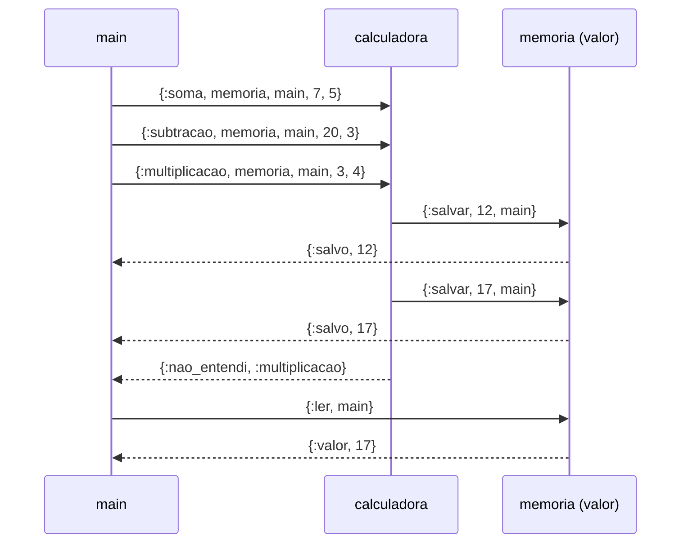

# Paradigmas de Programação — Aula 09: Modelo de atores com Elixir — `spawn`, `send` e `receive`

## Introdução

A nota 01 definiu o ator pelo estado privado, pela caixa de correio e pelo
comportamento, e enumerou as três ações que ele executa ao tratar uma mensagem.
A nota 02 apresentou a sintaxe de Elixir necessária para a leitura do código.
Esta nota trata das primitivas com que Elixir realiza o modelo: `spawn` cria um
processo, `send` deposita uma mensagem na caixa de correio de outro processo e
`receive` retira mensagens da caixa do processo corrente. Com elas, o estado de
um ator passa a ser escrito como argumento de uma função recursiva. O código de
apoio está em `codigo/02-processos.exs` e `codigo/03-calculadora.exs`.

## Objetivos de aprendizagem

Ao final desta nota, espera-se que o aluno seja capaz de:

1. Criar processos com `spawn` e trocar mensagens com `send` e `receive`.
2. Obter resposta de um processo enviando o próprio PID dentro da mensagem.
3. Impor prazo à espera com `receive ... after`.
4. Manter estado entre mensagens por recursão de cauda.
5. Explicar por que a ordem de chegada só é garantida entre um mesmo par
   remetente → destinatário, e como um programa se protege disso.
6. Observar a queda de um processo com `Process.monitor`.

## Desenvolvimento teórico

### As três primitivas

- `spawn(fn -> ... end)` cria um processo que executa a função dada e devolve o
  seu **PID** (*process identifier*), o endereço do novo processo. A função
  retorna de imediato; o processo criado executa de forma concorrente.
- `send(pid, mensagem)` deposita `mensagem` na caixa de correio do processo
  `pid` e retorna de imediato, sem esperar que a mensagem seja tratada. A
  mensagem é qualquer termo de Elixir, em geral uma tupla iniciada por um átomo
  que identifica o tipo do pedido.
- `receive` percorre a caixa de correio do processo corrente, da mensagem mais
  antiga para a mais nova, e retira a **primeira que casa com algum dos
  padrões**. Mensagens que não casam permanecem na caixa, na mesma posição. Se
  nenhuma casa, o processo bloqueia até chegar uma que case.
- `self()` devolve o PID do processo corrente.

Esse comportamento é o **recebimento seletivo** (*selective receive*). Uma
mensagem que nunca casa fica na caixa para sempre e é percorrida a cada
`receive` posterior; por isso um processo de vida longa costuma ter uma
cláusula final que casa com qualquer termo e descarta o que não reconhece.

### A resposta é outra mensagem

O envio é assíncrono e não tem valor de retorno. Para obter resposta, o
remetente inclui o próprio PID na mensagem, e o destinatário responde com um
novo `send` a esse PID. A parte 1 de `02-processos.exs`:

```elixir
defmodule Dobrador do
  def atender do
    receive do
      {:dobro, do_processo, numero} -> send(do_processo, {:resultado, numero * 2})
    end
  end
end

dobrador = spawn(fn -> Dobrador.atender() end)
send(dobrador, {:dobro, self(), 21})

receive do
  {:resultado, valor} -> IO.puts("resposta: #{valor}")
end
```

O `Dobrador` não conhecia o endereço do `main` antes da mensagem: o PID chega
como dado. É a forma concreta da primeira ação do ator, enviar mensagens a
atores cujo endereço conhece, e o modo pelo qual um ator passa a conhecer
outros. O `Dobrador` trata uma única mensagem e termina, porque `atender/0` não
chama a si mesma.

### Prazo: `receive ... after`

A cláusula `after` define um tempo máximo de espera, em milissegundos. Se
nenhuma mensagem que case chegar no prazo, executa-se o corpo do `after`:

```elixir
receive do
  :nunca_chega -> IO.puts("nao acontece")
after
  200 -> IO.puts("nada chegou em 200 ms")
end
```

É o equivalente ao `select` com `time.After` da aula 08, sem canal de
temporizador: o prazo é parte da própria construção de recebimento. A parte 3
do arquivo cria três processos, A, B e C, que esperam 300, 100 e 200 ms e
avisam o `main`; os avisos chegam na ordem B, C, A, a do envio, e não a da
criação dos processos.

### Estado por recursão de cauda

Elixir não tem variável mutável. Um processo que precisa lembrar algo entre
mensagens é escrito como uma função cujo argumento é o estado e que, ao final
do tratamento de cada mensagem, chama a si mesma com o estado seguinte:

```elixir
def loop(valor) do
  receive do
    {:salvar, novo_valor, do_processo} ->
      send(do_processo, {:salvo, novo_valor})
      loop(novo_valor)

    {:ler, do_processo} ->
      send(do_processo, {:valor, valor})
      loop(valor)
  end
end
```

A chamada `loop(novo_valor)` é a última expressão da cláusula, portanto uma **chamada
de cauda** (*tail call*), que a BEAM executa como salto: a pilha do processo
tem tamanho constante, qualquer que seja o número de mensagens tratadas. É a
terceira ação do ator da nota 01 escrita em código: ao tratar uma mensagem, o
ator define o estado com que tratará a próxima. O valor antigo não é alterado;
a nova chamada recebe outro argumento.

### Calculadora e memória

`03-calculadora.exs` é uma tradução para Elixir de um exemplo do professor
originalmente escrito em Erlang. Dois processos cooperam:

- a **calculadora** (`Calculadora.loop/0`) não tem estado. Recebe
  `{:soma, memoria, do_processo, primeiro, segundo}` ou `{:subtracao, memoria, do_processo, primeiro, segundo}`, imprime o
  resultado e o envia à memória como `{:salvar, resultado, do_processo}`. Operação
  desconhecida cai na cláusula `{operacao, _memoria, do_processo, _primeiro, _segundo}`, que responde
  `{:nao_entendi, operacao}` diretamente a quem pediu; qualquer outra mensagem
  cai na cláusula `mensagem_desconhecida` e é descartada com aviso;
- a **memória** (`Memoria.loop/1`) guarda o último valor como argumento.
  Responde `{:salvo, novo_valor}` a cada `:salvar` e `{:valor, valor}` a cada `:ler`.

O PID da memória e o do `main` viajam dentro da mensagem: a calculadora não
conhece nenhum dos dois de antemão. O diagrama omite a leitura inicial.



### Ordem entre remetentes distintos

O modelo garante que duas mensagens enviadas pelo **mesmo** remetente ao
**mesmo** destinatário chegam na ordem do envio. Entre remetentes distintos, não
há garantia. No exemplo, o `:salvar` vai da calculadora para a memória, e o
`:ler` final vai do `main` para a memória. Se o `main` enviasse o `:ler` logo
depois das três operações, nada impediria que ele chegasse à memória antes de
algum `:salvar`, e a leitura devolveria 0 ou 12 em vez de 17.

Por isso o `main` espera uma resposta por operação enviada antes de ler: três
operações, três respostas, sejam `{:salvo, valor_salvo}` vindas da memória ou
`{:nao_entendi, operacao}` vinda da calculadora. Quando a última chega, todo `:salvar`
já foi tratado, e o `:ler` seguinte encontra o valor final. A versão original do
exemplo esperava 100 ms com `sleep` antes de ler; a espera por tempo não
estabelece ordem, apenas a torna provável. Esta versão termina sem depender de
temporização.

A saída registrada (Elixir 1.17.3):

```text
memoria antes: 0
calculadora: 7 + 5 = 12
calculadora: 20 - 3 = 17
main: memoria confirmou 12
main: memoria confirmou 17
calculadora: nao entendi multiplicacao
main: calculadora recusou multiplicacao
memoria depois: 17
```

A intercalação das linhas varia entre execuções, e a ordem entre
`confirmou 17` e `recusou multiplicacao` não é garantida, porque as duas
mensagens chegam ao `main` por remetentes distintos. O valor final, 17, é fixo.

### Processos que caem

Um processo que levanta exceção não tratada termina; os demais continuam. O
processo observador pode ser avisado do término com `Process.monitor(pid)`, que
devolve uma referência e, quando o processo monitorado termina, deposita na
caixa do observador a mensagem `{:DOWN, referencia, :process, pid, motivo}`. A parte 4
de `02-processos.exs`:

```elixir
referencia = Process.monitor(fragil)
send(fragil, :falhar)

receive do
  {:DOWN, ^referencia, :process, _processo, {motivo, _pilha}} ->
    IO.puts("o processo caiu: #{Exception.message(motivo)}")
end
```

O operador `^` fixa o valor de `ref` no padrão. A saída é
`o processo caiu: falha simulada`, seguida de `o main continua vivo`: a queda
chegou ao `main` como mensagem. Um processo que recebe esse aviso e cria um
substituto é a ideia do Supervisor da nota 04, que usa a ligação (*link*),
bidirecional, em vez do monitor, unidirecional, com o mesmo efeito: a queda de
um processo chega a outro como informação.

## Fontes e leituras

- ELIXIR. **Processes**. Guia *Getting Started*. Disponível em:
  https://hexdocs.pm/elixir/processes.html.
- TATE, Bruce A. **Seven Languages in Seven Weeks.** Raleigh: The Pragmatic
  Bookshelf, 2010. Capítulo 6 (*Erlang*).
