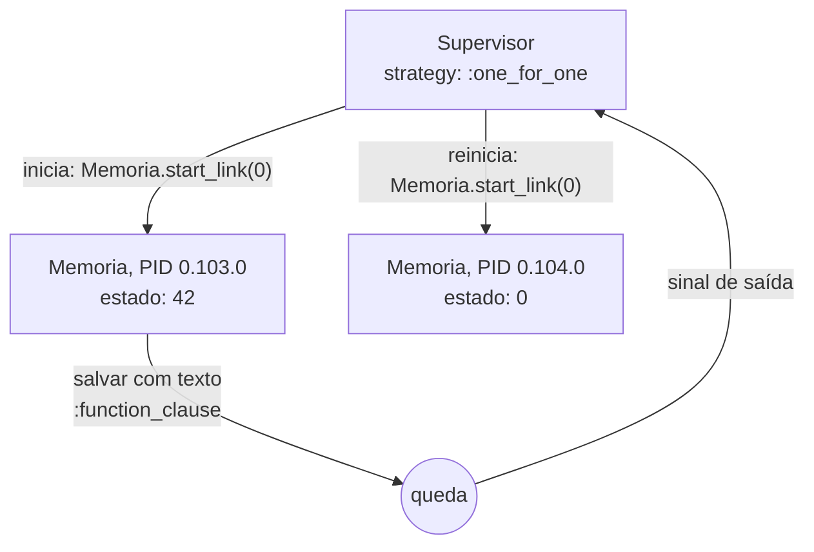

# Paradigmas de Programação — Aula 09: Modelo de atores com Elixir — GenServer e Supervisor

## Introdução

A nota 03 escreveu atores com as primitivas: um laço `receive`, uma chamada
recursiva com o novo estado e o PID do remetente enviado dentro da mensagem
para obter resposta. Esse arranjo se repete em quase todo processo de vida
longa. Esta nota trata das duas abstrações do OTP que o encapsulam: o
**GenServer**, que escreve o laço uma vez e deixa ao programador só o
tratamento de cada mensagem, e o **Supervisor**, que reinicia processos que
caem. O código de apoio está em `codigo/05-genserver.exs` e
`codigo/06-supervisor.exs`.

## Objetivos de aprendizagem

Ao final desta nota, espera-se que o aluno seja capaz de:

1. Reescrever um ator escrito com `receive` como GenServer, relacionando cada
   parte do laço a uma função do GenServer.
2. Distinguir `call` (síncrono, com resposta) de `cast` (assíncrono, sem
   resposta).
3. Explicar a filosofia *let it crash* e o papel do Supervisor.
4. Explicar por que o reinício devolve um processo correto, e não o estado que
   o processo anterior tinha.
5. Escolher estratégia e tipo de reinício de um Supervisor para um cenário dado.

## Desenvolvimento teórico

### OTP

O **OTP** (*Open Telecom Platform*) é o conjunto de bibliotecas e padrões de
projeto de processo que acompanha a BEAM. O nome é histórico: o conteúdo não
tem relação específica com telefonia. Um **comportamento** (*behaviour*) do OTP
é um módulo genérico que implementa a parte comum de um tipo de processo e
chama funções de retorno (*callbacks*) definidas pelo programador para a parte
específica. GenServer e Supervisor são os dois comportamentos desta nota.

### GenServer

Um **GenServer** (*generic server*) é um processo que mantém estado e trata
pedidos de outros processos. O módulo declara `use GenServer` e define os
*callbacks*:

- `init(argumento)` devolve `{:ok, estado_inicial}`;
- `handle_call(pedido, de, estado)` trata pedido **síncrono** e devolve
  `{:reply, resposta, novo_estado}`; o OTP envia a resposta ao chamador;
- `handle_cast(pedido, estado)` trata pedido **assíncrono** e devolve
  `{:noreply, novo_estado}`; ninguém espera resposta;
- `handle_info(mensagem, estado)` trata mensagens que não vieram por `call` nem
  por `cast`, como as enviadas com `send` ou por temporizador.

Do lado do cliente, `GenServer.call(servidor, pedido)` envia o pedido e bloqueia
até a resposta, com prazo padrão de 5000 ms; esgotado o prazo, o chamador
termina com erro. `GenServer.cast(servidor, pedido)` envia e retorna `:ok` de
imediato. Internamente, `call` é o padrão da nota 03: o pedido leva o PID do
chamador e uma referência única, e o chamador faz `receive ... after` à espera
de uma resposta com aquela referência.

`05-genserver.exs` reescreve a memória da nota 03:

```elixir
defmodule Memoria do
  use GenServer

  def start_link(inicial) do
    GenServer.start_link(__MODULE__, inicial, name: __MODULE__)
  end

  def salvar(valor), do: GenServer.cast(__MODULE__, {:salvar, valor})
  def ler, do: GenServer.call(__MODULE__, :ler)

  @impl true
  def init(inicial), do: {:ok, inicial}

  @impl true
  def handle_cast({:salvar, novo_valor}, _valor), do: {:noreply, novo_valor}

  @impl true
  def handle_call(:ler, _do_processo, valor), do: {:reply, valor, valor}
end
```

As funções `start_link/1`, `salvar/1` e `ler/0` formam a **API do cliente** e
executam no processo de quem as chama; os *callbacks* executam no processo da
memória. A separação no mesmo módulo é convenção: o cliente não envia mensagens
diretamente.

### Do laço `receive` ao GenServer

| `03-calculadora.exs` (primitivas) | `05-genserver.exs` (GenServer) |
|---|---|
| `spawn(fn -> Memoria.loop(0) end)` | `Memoria.start_link(0)`, que chama `init(0)` e recebe `{:ok, 0}` |
| argumento `valor` de `loop/1` | estado, último argumento de cada *callback* |
| `send(memoria, {:salvar, novo_valor, do_processo})` | `GenServer.cast(__MODULE__, {:salvar, novo_valor})` |
| cláusula `{:salvar, novo_valor, do_processo} -> ...; loop(novo_valor)` | `handle_cast({:salvar, novo_valor}, _valor)` devolve `{:noreply, novo_valor}` |
| `send(memoria, {:ler, self()})` seguido de `receive {:valor, valor}` | `GenServer.call(__MODULE__, :ler)` |
| cláusula `{:ler, do_processo} -> send(do_processo, {:valor, valor}); loop(valor)` | `handle_call(:ler, _do_processo, valor)` devolve `{:reply, valor, valor}` |
| chamada recursiva `loop(novo_valor)` | último elemento da tupla de retorno; o OTP faz a recursão |
| PID guardado em variável | nome registrado `Memoria` |
| cláusula `mensagem_desconhecida` para mensagem desconhecida | `handle_info/2` para mensagens fora de `call` e `cast` |

O laço, a recursão de cauda e o PID de resposta deixam de aparecer no código.
Uma diferença de comportamento: no `03`, cada `:salvar` era confirmado ao
`main`, porque o `:salvar` vinha da calculadora e o `:ler` do `main`, dois
remetentes distintos. No `05`, os dois `cast` e o `call` partem do mesmo
processo para o mesmo destino, e a ordem entre um mesmo par é preservada: o
`call` final encontra 42 sem confirmação intermediária.

### Registro por nome

A opção `name: __MODULE__` registra o processo com o nome `Memoria`. O cliente
endereça o nome, e não o PID, e `Process.whereis(Memoria)` devolve o PID atual.
O registro é condição para o Supervisor: um processo reiniciado é um processo
novo, com PID novo, e um cliente que guardasse o PID antigo estaria endereçando
um processo morto.

### *Let it crash*

A filosofia de construção de sistemas tolerantes a falha formulada por Armstrong
(2003) para Erlang separa o trabalho da recuperação. O processo que executa o
trabalho não tenta prever e tratar toda falha possível com código defensivo:
diante de uma situação que não sabe resolver, ele termina. Outro processo, que o
observa, decide o que fazer, em geral reiniciá-lo em um estado inicial
conhecido. O código do trabalho fica sem `try`/`rescue` para falhas que não sabe
tratar, e a política de recuperação fica concentrada em um só lugar. O
isolamento entre processos da nota 03 é o que torna a filosofia viável: a queda
de um processo não corrompe o estado de nenhum outro.

### Supervisor

Um **Supervisor** é um processo cuja única função é iniciar uma lista de
processos filhos e reagir ao término deles. `06-supervisor.exs`:

```elixir
filhos = [{Memoria, 0}]
{:ok, _supervisor} = Supervisor.start_link(filhos, strategy: :one_for_one)
```

A entrada `{Memoria, 0}` indica que o filho é iniciado com `Memoria.start_link(0)`.
Na `Memoria` deste arquivo, `handle_cast` tem a guarda `when is_number(novo_valor)`.
O programa salva 42 e, em seguida, envia `Memoria.salvar("quarenta e dois")`: o
pedido não casa com nenhuma cláusula, o processo termina com motivo
`:function_clause`, e o Supervisor inicia uma nova `Memoria`. A saída registrada
(Elixir 1.17.3):

```text
valor guardado: 42

== Mensagem malformada
memoria caiu: :function_clause

== Depois do reinicio
PID antes: #PID<0.103.0>, PID depois: #PID<0.104.0>
valor guardado: 0
```

O nome `Memoria` volta a responder, mas o PID é outro e o valor guardado voltou
a 0. **O estado morre com o processo**: o reinício executa `init(0)` de novo e
devolve um processo correto, não o estado que o anterior tinha. Um estado que
precisa sobreviver à queda tem de estar fora do processo que cai — em outro
processo, em disco ou em banco de dados.



### Estratégias e tipos de reinício

A **estratégia** define quais filhos são reiniciados quando um deles termina:

| Estratégia | Quando um filho termina | Uso típico |
|---|---|---|
| `:one_for_one` | só ele é reiniciado | filhos independentes |
| `:one_for_all` | todos os filhos são terminados e reiniciados | filhos que só funcionam juntos |
| `:rest_for_one` | ele e os filhos iniciados depois dele são reiniciados | dependência em ordem de início |

O **tipo de reinício** (*restart*) é definido por filho e decide se o término
provoca reinício:

| Tipo | Reinicia quando | Uso típico |
|---|---|---|
| `:permanent` (padrão do GenServer) | sempre | servidor que deve estar sempre no ar |
| `:transient` | só em término anormal (motivo diferente de `:normal`, `:shutdown` ou `{:shutdown, termo}`) | tarefa que termina ao concluir, mas deve ser refeita se cair |
| `:temporary` | nunca | processo cuja falha não deve ser repetida |

### O limite do reinício

O reinício resolve a falha **transitória**, a que depende de condição
passageira (um serviço externo fora do ar, um tempo esgotado). Um defeito
**determinístico**, que se repete com a mesma entrada, derruba o processo
reiniciado da mesma forma. Para que o Supervisor não reinicie em laço, ele tem
um limite: `max_restarts` reinícios em `max_seconds` segundos, por padrão 3
reinícios em 5 segundos (ELIXIR, s.d.b). Excedido o limite, o Supervisor
termina todos os filhos e termina a si mesmo, e a falha sobe para o Supervisor
acima dele na árvore. A nota 05 retoma a distinção entre falha transitória,
defeito determinístico e erro de negócio no exemplo de pagamentos.

## Fontes e leituras

- ARMSTRONG, Joe. **Making reliable distributed systems in the presence of
  software errors.** Tese (Doutorado) — Royal Institute of Technology,
  Estocolmo, 2003.
- ELIXIR. **GenServer**. Documentação do módulo, Elixir v1.17. Disponível em:
  https://hexdocs.pm/elixir/GenServer.html. (ELIXIR, s.d.a)
- ELIXIR. **Supervisor**. Documentação do módulo, Elixir v1.17. Disponível em:
  https://hexdocs.pm/elixir/Supervisor.html. (ELIXIR, s.d.b)
- TATE, Bruce A. **Seven Languages in Seven Weeks.** Raleigh: The Pragmatic
  Bookshelf, 2010. Capítulo 6 (*Erlang*).
