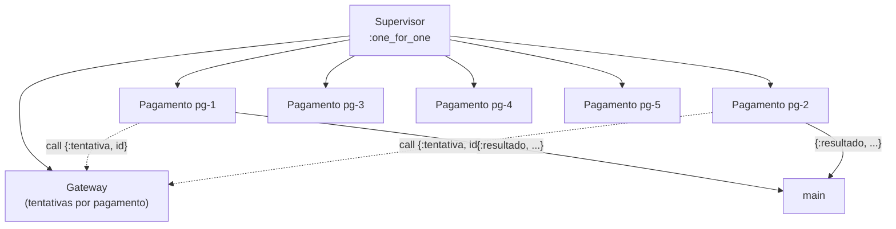

# Paradigmas de Programação — Aula 09: Modelo de atores com Elixir — Exemplo: processador de pagamentos

## Introdução

Esta nota aplica processos, GenServer e Supervisor a um problema de sistema
real: autorizar vários pagamentos num gateway externo que demora e às vezes
falha. O caso reúne as três propriedades do modelo de atores tratadas nas notas
anteriores — estado privado, uma mensagem por vez e falha isolada por processo —
e acrescenta a distinção entre os três tipos de erro que um sistema assim
encontra: a falha transitória, que o reinício resolve; o erro de negócio, que é
uma resposta; e o defeito determinístico, que o reinício não resolve.

## Objetivos de aprendizagem

Ao final desta nota, espera-se que o aluno seja capaz de:

1. Estruturar trabalhos independentes como um processo por tarefa, iniciados e
   vigiados por um Supervisor.
2. Explicar por que a queda de um processo não afeta os demais e por que o
   estado que precisa sobreviver ao reinício fica fora do processo que cai.
3. Distinguir falha transitória, erro de negócio e defeito determinístico, e
   dizer qual deles o *let it crash* trata.
4. Explicar por que o trabalho demorado não pode ficar dentro do tratamento de
   mensagem de um ator compartilhado.
5. Comparar os três modelos concorrentes da disciplina — trava, canais e
   atores — pelo lugar do estado, pela forma de comunicação e pelo efeito de
   uma falha.

## Desenvolvimento teórico

### O problema

Cinco pagamentos chegam juntos, e cada um precisa ser autorizado por um gateway
externo. Cada autorização demora um tempo diferente, e o gateway pode falhar por
motivo passageiro — um *timeout*, por exemplo. Os desfechos são fixos no
exemplo, para que a saída seja a mesma em toda execução:

| Pagamento | Valor | Latência | Desfecho no gateway |
|---|---|---|---|
| pg-1 | R$ 120,00 | 100 ms | aprovado |
| pg-2 | R$ 89,90 | 150 ms | falha transitória (*timeout*) na 1ª tentativa; aprovado na 2ª |
| pg-3 | R$ 1.500,00 | 80 ms | recusado: saldo insuficiente |
| pg-4 | R$ 45,00 | 200 ms | aprovado |
| pg-5 | R$ 310,00 | 120 ms | aprovado |

Em sequência, as cinco autorizações custam a soma das latências mais a nova
tentativa da pg-2: 100 + 150 + 80 + 200 + 120 + 150 = 800 ms. Os pagamentos são
**independentes** e passam o tempo **esperando** o gateway, como as consultas
da cotação da aula 08. Há uma exigência a mais: a falha da pg-2 não pode
impedir nem atrasar os outros quatro.

A latência é simulada com `Process.sleep`, para que o programa execute sem rede.
Num sistema real, a espera seria uma requisição HTTP ao gateway.

### A estrutura

O programa tem três tipos de processo:

- **`Gateway`**, um GenServer registrado por nome, que simula o serviço externo
  e conta as tentativas de cada pagamento.
- **`Pagamento`**, um GenServer de vida curta, um por pagamento: consulta o
  gateway, envia o resultado ao processo principal e termina.
- **O processo principal**, que inicia o Supervisor e recebe os cinco
  resultados.



O diagrama mostra só duas das cinco setas de cada tipo; as demais são iguais.

**O estado que sobrevive ao reinício fica no `Gateway`.** A pg-2 precisa falhar
na primeira tentativa e passar na segunda, e para isso alguém precisa lembrar
quantas tentativas já houve. Esse alguém não pode ser o processo do pagamento:
o processo reiniciado pelo Supervisor começa com o estado inicial, como na nota
04, e não saberia que já tentou. O `Gateway` guarda um *map* de `id` para número
de tentativas e o incrementa a cada pedido:

```elixir
def handle_call({:tentativa, id}, _do_processo, tentativas) do
  tentativa = Map.get(tentativas, id, 0) + 1
  {:reply, tentativa, Map.put(tentativas, id, tentativa)}
end
```

**A espera fica no processo do pagamento, e não dentro do `Gateway`.** A função
`autorizar` é executada pelo processo que a chama: pede o número da tentativa ao
`Gateway` com um `call`, que responde de imediato, e só depois dorme a
latência:

```elixir
def autorizar(pagamento) do
  tentativa = GenServer.call(__MODULE__, {:tentativa, pagamento.id})
  Process.sleep(pagamento.latencia)
  # ... decide o desfecho a partir de @desfechos e da tentativa
end
```

A posição do `Process.sleep` decide o tempo total. Um ator trata uma mensagem
por vez (nota 01): se a espera estivesse dentro do `handle_call`, o `Gateway`
atenderia o primeiro pedido, dormiria a latência dele, e só então retiraria o
segundo da caixa de correio. Os cinco pagamentos continuariam sendo cinco
processos, mas seriam atendidos em fila, e o tempo total voltaria a ser a soma,
cerca de 800 ms. A propriedade que elimina a condição de corrida — ninguém
intercala com o tratamento de uma mensagem — é a mesma que faz de um ator
compartilhado um gargalo. A regra que decorre daí: o tratamento de mensagem de
um ator compartilhado faz só o trabalho que precisa do estado dele, e o trabalho
demorado fica no processo de quem pediu.

**O pagamento termina sozinho, e a falha transitória o derruba.** O
`Pagamento` faz o trabalho em `handle_continue/2`, que o OTP executa logo depois
do `init/1`, dentro do próprio processo. O `init/1` retorna de imediato porque o
Supervisor inicia os filhos um de cada vez e espera o `init/1` de cada um: com a
autorização dentro do `init/1`, o segundo pagamento só começaria quando o
primeiro terminasse. No `handle_continue/2`, o desfecho decide o fim do
processo:

```elixir
case Gateway.autorizar(pagamento) do
  {:aprovado, tentativa} ->
    send(main, {:resultado, pagamento, :aprovado, tentativa})
    {:stop, :normal, estado}

  {:recusado, motivo, tentativa} ->
    send(main, {:resultado, pagamento, {:recusado, motivo}, tentativa})
    {:stop, :normal, estado}

  {:falha, motivo, tentativa} ->
    IO.puts("  [log] #{pagamento.id} caiu na tentativa #{tentativa}: #{motivo} -> supervisor reinicia")
    raise motivo
end
```

Aprovado e recusado terminam com `:normal`. A falha transitória levanta
exceção, sem `try`/`rescue`: o pagamento não sabe o que fazer com um *timeout*
do gateway, e por isso não tenta.

**O tipo de reinício é `:transient`.** O módulo declara
`use GenServer, restart: :transient`: o Supervisor reinicia o processo só se
ele terminar de forma anormal. Com o padrão `:permanent`, o Supervisor
reiniciaria também os pagamentos que terminaram com `:normal`; cada reinício
executaria a autorização de novo, e o laço só pararia ao esgotar o limite de
reinícios. Com `:temporary`, a pg-2 não seria reiniciada e o seu resultado
nunca chegaria.

**O processo principal recebe os resultados com prazo.** Os cinco filhos
recebem o PID do `main` na especificação; o `main` executa cinco `receive`, cada
um com `after 1000`, para não ficar bloqueado se um resultado não chegar.

### A saída

Execução em `elixir:1.17` (Elixir 1.17.3):

```
== 5 pagamentos processados ao mesmo tempo
  pg-3  recusado: saldo insuficiente  (86 ms)
  pg-1  aprovado  R$ 120.00  (105 ms)
  pg-5  aprovado  R$ 310.00  (123 ms)
  [log] pg-2 caiu na tentativa 1: timeout do gateway -> supervisor reinicia
  pg-4  aprovado  R$ 45.00  (204 ms)
  pg-2  aprovado  R$ 89.90  (317 ms, 2a tentativa)
tempo total: 317 ms (em sequencia seriam 800 ms)
```

Os tempos variam alguns milissegundos entre execuções; a ordem das linhas e os
desfechos não variam. A linha do tempo dos cinco processos:

```mermaid
gantt
    title Cinco pagamentos ao mesmo tempo (ms desde o início)
    dateFormat x
    axisFormat %L
    section pg-1
    aprovado                    : 0, 100
    section pg-2
    tentativa 1 - timeout      : crit, 0, 150
    tentativa 2 - aprovado     : 150, 300
    section pg-3
    recusado                    : 0, 80
    section pg-4
    aprovado                    : 0, 200
    section pg-5
    aprovado                    : 0, 120
```



A barra crítica da pg-2 termina em 150 ms com a queda do processo; o Supervisor
inicia um processo novo, que pede a tentativa 2 ao `Gateway` e espera mais
150 ms.

### O que o exemplo mostra

**Isolamento de falha.** A queda da pg-2 não afeta os outros quatro: a pg-4,
que ainda esperava o gateway quando a pg-2 caiu, termina normalmente em 200 ms.
Não há estado compartilhado que a queda pudesse deixar pela metade — o estado
de cada pagamento morre com o processo dele, e o do `Gateway` não é tocado. A
estratégia `:one_for_one` reinicia só o filho que caiu.

**Erro de negócio não é falha.** A recusa da pg-3 por saldo insuficiente é um
desfecho previsto do domínio, e o programa o trata como valor de retorno:
`{:recusado, motivo, tentativa}`, que vira uma mensagem ao `main` e um término
`:normal`. Se a recusa levantasse exceção, o Supervisor reiniciaria o
pagamento, o gateway o recusaria de novo, e a recusa nunca chegaria ao `main`
como resposta. O *let it crash* (Armstrong, 2003) se aplica ao que o processo
não sabe tratar e que tem chance de não se repetir — a falha transitória —, e
não ao que faz parte do contrato da operação.

**O limite do modelo: o defeito determinístico.** Um defeito que se repete a
cada tentativa — um dado malformado no pagamento, um erro no código de
autorização — derruba o processo reiniciado pelo mesmo motivo, e o reinício não
resolve nada. O Supervisor limita os reinícios: com os valores padrão,
`max_restarts: 3` em `max_seconds: 5` (Elixir, s.d.), a quarta queda em cinco
segundos faz o Supervisor encerrar todos os filhos e terminar ele mesmo. No
exemplo, como o Supervisor foi iniciado com `start_link` pelo `main`, o término
se propaga pela ligação e encerra o programa. Num sistema maior, o Supervisor
derrubado é filho de outro, que decide no nível de cima. O código não demonstra
o caso, para manter a saída estável; para observá-lo, basta alterar o
desfecho da pg-2 em `@desfechos` para um que falhe em toda tentativa. Há ainda
um limite de
domínio: repetir uma autorização de pagamento só é seguro se o gateway
reconhecer a repetição, o que num sistema real se faz com uma chave de
idempotência enviada a cada tentativa.

**O tempo total é o do mais lento, contando o retry.** As cinco esperas se
sobrepõem, como na cotação da aula 08, e o tempo total é aproximadamente o do
pagamento que termina por último. Esse pagamento não é o de maior latência, a
pg-4 com 200 ms, e sim a pg-2, que soma a tentativa que falhou e a nova:
150 + 150 = 300 ms. A medição dá cerca de 317 ms, contra 800 ms em sequência; a
diferença de alguns milissegundos é o custo de criar processos, reiniciar e
trocar mensagens.

### Ligação com a cotação da aula 08

O raciocínio de tempo é o mesmo da cotação: tarefas independentes e limitadas
por E/S, cujas esperas se sobrepõem sem exigir mais de um núcleo. A diferença
está no tratamento de falha. Na cotação, um fornecedor lento é descartado pelo
prazo do `select`, e quem coordena decide sozinho. No processador de
pagamentos, quem cai é reiniciado por um processo cuja única função é vigiar, e
o código do trabalho não contém tratamento de falha. O `main` ainda usa prazo
(`after 1000`), pelo mesmo motivo do `select` da cotação: nenhum receptor
deve esperar indefinidamente por uma mensagem que pode não vir.

### Os três modelos concorrentes

A aula 08 e esta aula apresentaram três modelos para o mesmo problema —
processamento concorrente com estado. A tabela os resume pelos três critérios
que os distinguem:

| | Java: threads e trava | Go: gorrotinas e canais | Elixir: atores |
|---|---|---|---|
| **Onde fica o estado** | Na memória compartilhada; qualquer thread o lê e escreve | Em qualquer gorrotina; por convenção, com um único dono, que o recebe e repassa por canal | Dentro de um processo, privado; nenhum outro o lê ou escreve |
| **Como se comunica** | Lendo e escrevendo a mesma memória, com trava (`synchronized`) em volta da seção crítica | Enviando e recebendo valores por um canal; sem *buffer*, o envio sincroniza remetente e destinatário | Mensagem assíncrona endereçada ao PID, depositada na caixa de correio do destinatário |
| **O que acontece numa falha** | A exceção não capturada encerra a thread; o estado compartilhado pode ficar pela metade, e as demais threads continuam sobre ele | Um `panic` não recuperado numa gorrotina encerra o programa inteiro | O processo cai sozinho; o Supervisor o reinicia com o estado inicial, e os demais não são afetados |

Em Go, o compartilhamento de memória continua possível e cabe ao programador
evitá-lo; em Elixir, a linguagem não o oferece. O modelo de atores troca a
condição de corrida e a trava por duas restrições: todo acesso ao estado passa
por uma mensagem, e um ator compartilhado serializa quem depende dele.

## Exemplos

O programa completo está em `codigo/08-pagamentos.exs`:

```sh
docker run --rm -v "$PWD":/w -w /w elixir:1.17 elixir 08-pagamentos.exs
```

O arquivo desliga o `Logger` com `Logger.configure(level: :none)`: o relatório
de queda do OTP ocupa dezenas de linhas, e a queda é mostrada pela linha
`[log]` que o próprio pagamento imprime.

## Fontes e leituras

- ARMSTRONG, Joe. **Making reliable distributed systems in the presence of
  software errors.** Tese (Doutorado) — Royal Institute of Technology,
  Estocolmo, 2003.
- ELIXIR. **Supervisor.** Documentação da biblioteca padrão. Disponível em:
  https://hexdocs.pm/elixir/Supervisor.html.
- ELIXIR. **GenServer.** Documentação da biblioteca padrão. Disponível em:
  https://hexdocs.pm/elixir/GenServer.html.
