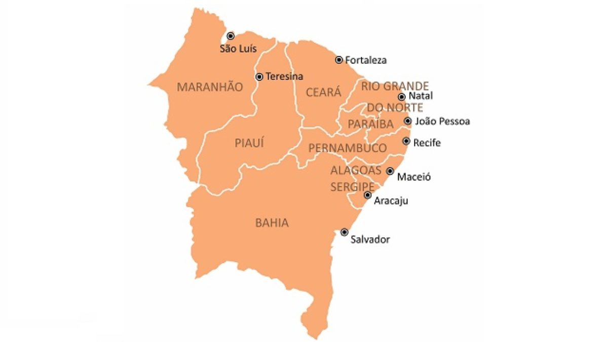
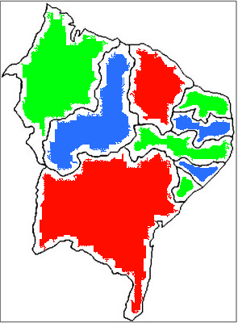

# Prolog: Exemplo de problema - Coloração de Mapa

Tema: Lógico

# Satisfação de Restrições

Um dos usos mais comuns de paradigma lógico é o de Satisfação de Restrições. As restrições são regras de um domínio de conhecimento que queremos aplicar um processamento sem fazer o algoritmo que resolve este problema.

No paradigma lógico, este processamento é trivial. 

Vamos para um exemplo clássico.

## Coloração de Mapas

A região Nordeste do Brasil é composta por 9 estados em que há muitas fronteiras. Por exemplo, o estado da Bahia faz fronteira com 5 estados: Maranhão, Piauí, Pernambuco, Alagoas e Sergipe:



Queremos colorir o mapa em que cada estado recebe uma cor. Restrições:

1) A quantidade de cores precisa ser a mínima possível

2) Estados que fazem fronteira não podem ter as mesmas cores.

Podemos iniciar definindo uma base de conhecimento de cores. Vamos iniciar com 3 cores diferentes. Temos que definir a associação também ou seja, vermelho ≠ verde  ↔ verde ≠ vermelho 

```prolog
diferentes(vermelho, verde). diferentes(verde, vermelho).
diferentes(vermelho, azul).  diferentes(azul, vermelho).
diferentes(vermelho, amarelo). diferentes(amarelo, vermelho).

diferentes(azul, verde). diferentes(verde, azul).
diferentes(azul, amarelo). diferentes(amarelo, azul).

diferentes(verde, amarelo). diferentes(amarelo, verde).
```

Agora a regra de coloração fica trival. Vamos definir uma regra de fronteira entre os estados. As cores precisam ser diferentes entre si. 

```prolog
fronteira(X, Y) :- diferentes(X, Y), diferentes(Y, X).
```

Vamos definir os estados como variáveis e para simplificar, uso a sigla de cada estado em maiúsculo. A variável vai receber a cor devida. Como formação da regra, uso da regra "fronteira" para definir os estados que têm fronteira:

```prolog
coloracao(BA, MA, PI, CE, RN, PB, PE, AL, SE) :-
    fronteira(BA, MA),
    fronteira(BA, PI),
    fronteira(BA, PE),
    fronteira(BA, AL),
    fronteira(BA, SE),
    fronteira(MA, PI),
    fronteira(PI, CE),
    fronteira(PI, PE),
    fronteira(CE, PB),
    fronteira(CE, RN),
    fronteira(CE, PE),
    fronteira(RN, PB),
    fronteira(PB, PE),
    fronteira(PE, AL),
    fronteira(AL, SE).
```

Assim, basta carregar a base de conhecimento e executar a regra de coloração:

```prolog
?- coloracao(BA, MA, PI, CE, RN, PB, PE, AL, SE).
BA = CE, CE = vermelho,
MA = RN, RN = PE, PE = SE, SE = verde,
PI = PB, PB = AL, AL = azul .
```

Mapa de resultado:



Podemos ver que a cor amarela não foi usada. Então, só precisamos de 3 cores para colorir o mapa:

```prolog
diferentes(vermelho, verde). diferentes(verde, vermelho).
diferentes(vermelho, azul).  diferentes(azul, vermelho).
diferentes(azul, verde). diferentes(verde, azul).
```